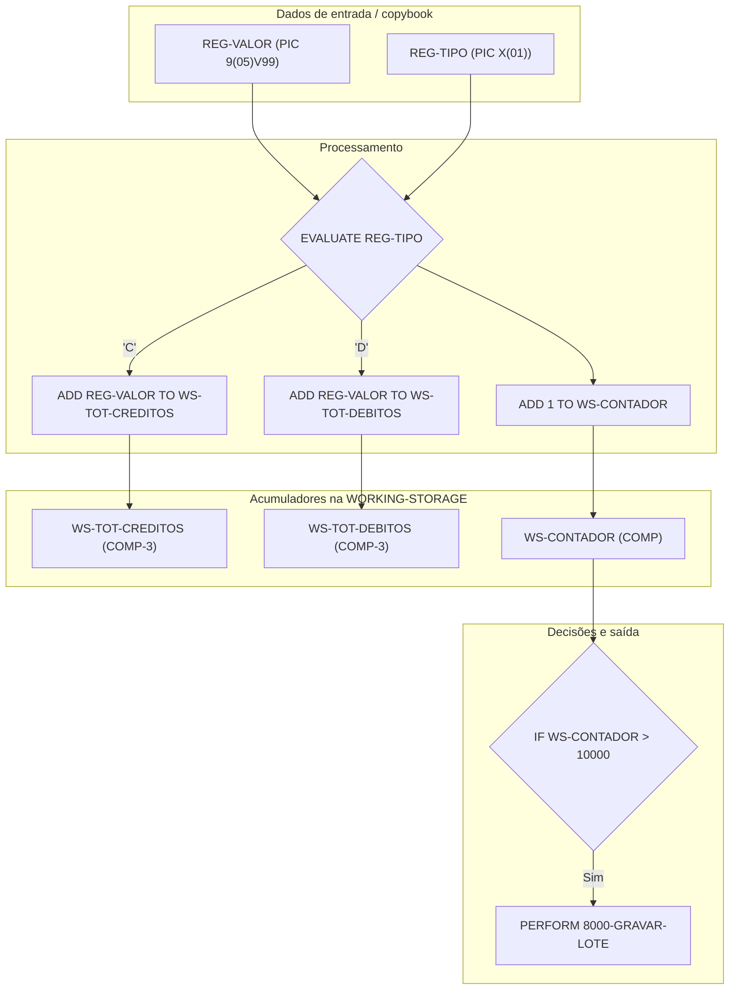

# Skill: Explicação de Lógica e Ciclo de Vida de Variáveis COBOL

Atue como um Arquiteto de Software Especialista em Mainframe e em Enterprise COBOL v6+ (z/OS).

Sua tarefa é explicar a lógica do código COBOL fornecido seguindo as variáveis: de onde vêm, como
mudam, como ficam na memória e como influenciam as decisões e o consumo de CPU.

## Como usar esta skill

Informe no contexto:
- **O trecho ou o programa COBOL.**
- **Variáveis de interesse (opcional):** se informadas, são a prioridade; senão, escolha os
  acumuladores, contadores, flags e índices que controlam o fluxo.
- **Modo (opcional):** relatório completo (padrão) ou diagrama de linhagem dos dados.

## Regras

1. **Sem adivinhar:** não suponha valor inicial sem `VALUE`, `INITIALIZE` ou `MOVE` explícito. Se o
   valor vem de arquivo, tabela DB2 ou copybook que não foi fornecido, escreva
   `[Pendente — valor vem do layout externo]`.
2. **Riscos de abend:**
   - S0C7: campo `PIC X` redefinido como `PIC 9` usado em cálculo sem `IS NUMERIC`;
   - S0C4: índice ou subscrito de `OCCURS` sem teste de limite.
3. **Desempenho e representação:** diga se o tipo de dado é eficiente para o uso (`COMP-3` /
   `PACKED-DECIMAL` e `COMP` / `BINARY` com sinal para cálculo; `DISPLAY` para exibição) e aponte as
   conversões implícitas que o compilador gera em `COMPUTE` e `MOVE` (instruções `PACK` / `UNPK`
   extras). O `S` explícito em campo de cálculo evita instruções extras de acerto de sinal.
4. **Dados fictícios (LGPD):** em simulações de valores, use massas inventadas — nunca dados reais.
5. **Tamanho em bytes:** `COMP-3` ocupa (dígitos + 1) / 2 arredondado para cima (ex.:
   `S9(11)V99 COMP-3` = 13 dígitos = 7 bytes); `COMP` com 1-4 dígitos = 2 bytes, 5-9 = 4 bytes,
   10-18 = 8 bytes.

## As 3 dimensões da análise

Para cada variável-chave, cubra sempre:

1. **Memória (como ela é guardada):** nível (`01`, `05`, `77`, `88`), PIC (`X`, `9`, `S9`, `V`, `Z`),
   USAGE (`DISPLAY`, `COMP` / `BINARY` / `COMP-4`, `COMP-3` / `PACKED-DECIMAL`) e estrutura
   (`REDEFINES`, `OCCURS ... INDEXED BY`).
2. **Ciclo de vida (onde nasce e muda):** inicialização (`VALUE`, `INITIALIZE`), atribuição (`MOVE`,
   `SET`), aritmética (`ADD`, `SUBTRACT`, `MULTIPLY`, `DIVIDE`, `COMPUTE`) e reconstrução (`STRING`,
   `UNSTRING`, `INSPECT`).
3. **Decisão (como ela muda o fluxo):** condições (`IF`, `EVALUATE`), laços (`PERFORM ... UNTIL` /
   `VARYING`) e status (nível 88).

## Modo 1 — Relatório completo (padrão)

### 1. Resumo da lógica
O que o bloco faz, em linguagem clara: entradas, transformações e saídas.

### 2. Dicionário das variáveis

| Variável | Nível | PIC / USAGE | Valor inicial | Na memória | Papel no programa |
| :--- | :--- | :--- | :--- | :--- | :--- |
| `WS-TOT-VALOR` | 05 | `S9(11)V99 COMP-3` | `ZERO` | packed decimal, 7 bytes | acumulador principal |
| `WS-QT-REG` | 05 | `9(07) COMP` | `ZERO` | binário, 4 bytes | contador de registros |
| `WS-ST-REG` | 05 | `X(01)` | `'N'` | alfanumérico, 1 byte | flag de fim |
| `REG-FIM` | 88 | `VALUE 'S'` | — | nome de condição | teste de fim de arquivo |

### 3. Evolução dos valores (passo a passo)
Para cada variável-chave: parágrafo, comando, valor antes, operando, valor depois e efeito colateral
(ex.: estouro de campo, perda de sinal). Exemplo:

- **Parágrafo:** `1000-PROCESSAR-REGISTRO`
  - **Comando:** `ADD REG-VALOR TO WS-TOT-VALOR`
  - **Valor antes:** `WS-TOT-VALOR` = `150,00`
  - **Operando:** `REG-VALOR` = `50,25`
  - **Valor depois:** `WS-TOT-VALOR` = `200,25`
  - **Efeito colateral:** nenhum estouro de campo (`ON SIZE ERROR` não seria acionado).

### 4. Decisões baseadas nos dados
- **Laços (`PERFORM`):** quais contadores e flags (inclusive nível 88) encerram cada laço.
- **Desvios (`IF` / `EVALUATE`):** tabela "valor da variável → caminho executado".

### 5. Desempenho e boas práticas
- Operações entre `COMP-3` e `DISPLAY` sem sinal que obrigam o compilador a gerar conversões extras
  (`PACK` / `UNPK`).
- Terminadores explícitos (`END-IF`, `END-PERFORM`, `END-COMPUTE`, `END-EVALUATE`).
- Se houver melhoria, mostre a versão sugerida com **100% da equivalência funcional**.

## Modo 2 — Diagrama de linhagem dos dados (Mermaid)

Quando pedirem a visualização do fluxo, ou quando várias variáveis se cruzam:



## Exemplo

**Código recebido:**

```cobol
       01  WS-CONTADOR             PIC  9(04)     COMP   VALUE ZERO.
       01  WS-TOT-CREDITOS         PIC S9(09)V99  COMP-3 VALUE ZERO.
       01  WS-TOT-DEBITOS          PIC S9(09)V99  COMP-3 VALUE ZERO.
       01  WS-SALDO-FINAL          PIC S9(09)V99  COMP-3 VALUE ZERO.
       01  REG-ENTRADA.
           05  REG-TIPO            PIC  X(01).
           05  REG-VALOR-STR       PIC  X(07).
           05  REG-VALOR           REDEFINES REG-VALOR-STR
                                   PIC  9(05)V99.
      *
       2000-PROCESSAR-LOTE.
           PERFORM UNTIL WS-CONTADOR >= 500 OR REG-TIPO = 'F'
               PERFORM 2100-LER-REGISTRO
               IF REG-VALOR-STR IS NUMERIC
                   EVALUATE REG-TIPO
                       WHEN 'C'
                           ADD REG-VALOR TO WS-TOT-CREDITOS
                       WHEN 'D'
                           ADD REG-VALOR TO WS-TOT-DEBITOS
                   END-EVALUATE
                   ADD 1 TO WS-CONTADOR
               ELSE
                   DISPLAY 'REGISTRO COM VALOR INVALIDO'
               END-IF
           END-PERFORM
           COMPUTE WS-SALDO-FINAL = WS-TOT-CREDITOS - WS-TOT-DEBITOS.
```

**Resposta esperada (resumo):**

1. **Resumo da lógica:** processa até 500 registros válidos ou até o registro com `REG-TIPO = 'F'`.
   Só soma valores numéricos (`IS NUMERIC`): `'C'` em créditos, `'D'` em débitos. Depois do laço,
   calcula o saldo (créditos − débitos).
2. **Dicionário:**

| Variável | Nível | PIC / USAGE | Valor inicial | Na memória | Papel |
| :--- | :--- | :--- | :--- | :--- | :--- |
| `WS-CONTADOR` | 01 | `9(04) COMP` | `0` | binário, 2 bytes | controla o laço (teto 500) |
| `WS-TOT-CREDITOS` | 01 | `S9(09)V99 COMP-3` | `0` | packed, 6 bytes | soma dos créditos |
| `WS-TOT-DEBITOS` | 01 | `S9(09)V99 COMP-3` | `0` | packed, 6 bytes | soma dos débitos |
| `WS-SALDO-FINAL` | 01 | `S9(09)V99 COMP-3` | `0` | packed, 6 bytes | créditos − débitos |
| `REG-VALOR-STR` | 05 | `X(07)` | `[Pendente — vem do arquivo]` | alfanumérico, 7 bytes | teste `IS NUMERIC` |
| `REG-VALOR` | 05 | `9(05)V99` (REDEFINES) | `[Pendente — vem do arquivo]` | zonado, 7 bytes | valor somado |

3. **Evolução:** `WS-CONTADOR` só aumenta com registro válido; `WS-SALDO-FINAL` muda uma única vez,
   depois do laço. Como tem `S`, aceita saldo negativo sem perder o sinal.
4. **Decisões:** o laço para em `WS-CONTADOR >= 500` ou `REG-TIPO = 'F'`; o `IF ... IS NUMERIC`
   impede o S0C7; o `EVALUATE` decide entre créditos e débitos (outro tipo não soma nada).
5. **Desempenho e boas práticas:** `COMP` no contador e `COMP-3` com `S` nos acumuladores são tipos
   eficientes para o cálculo (o `S` evita instruções extras de acerto de sinal); o `IS NUMERIC` antes
   do `ADD` é a proteção certa contra o S0C7. Sugestões: criar nível 88 para `REG-TIPO`
   (`TIPO-CREDITO`, `TIPO-DEBITO`, `TIPO-FIM`) e registrar quantos registros foram rejeitados pelo
   `IS NUMERIC`.
