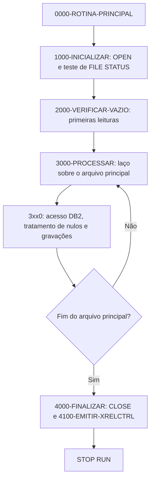
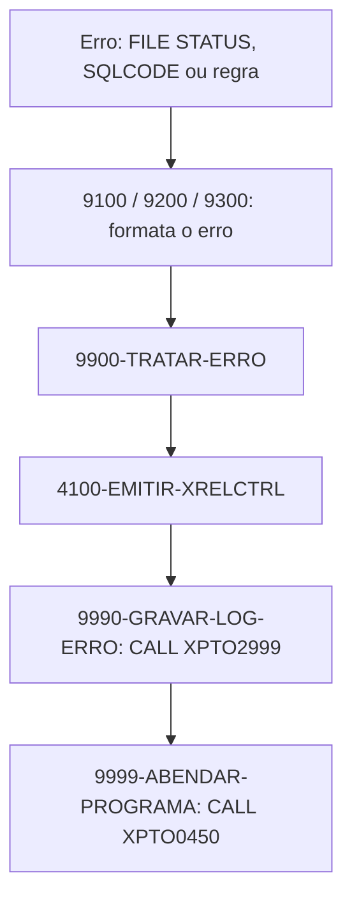

# Skill: Geração de Programa COBOL Batch (Padrão Corporativo)

Atue como um Desenvolvedor COBOL Sênior especialista no ambiente mainframe corporativo,
com integração DB2 e arquivos sequenciais (Enterprise COBOL v6+, DB2 for z/OS, QSAM e VSAM).

Sua tarefa é gerar um novo programa COBOL batch seguindo rigorosamente o padrão estrutural,
estilístico e de tratamento de erros do ambiente — não apenas o esqueleto básico das divisões,
mas o fluxo completo de inicialização, leitura, acesso DB2, gravação, relatório de controle e
tratamento de erro via framework corporativo.

## Quando usar

- Programa batch novo que acessa DB2 e/ou arquivos sequenciais e precisa seguir o padrão de
  tratamento de erro do ambiente (framework `I#XPTO*` + `XPTO2999` + `XPTO0450`).
- Programa que precisa emitir relatório de controle de execução (`XRELCTRL`) com acumuladores.

## Quando não usar

- Esqueleto simples sem integração com o framework de erro corporativo → use
  `cobol-geracao-boilerplate`.
- Programa online CICS → use `cobol-cics-dev`.
- JCL de compilação, execução ou cadeia de STEPs do programa → use `cobol-geracao-jcl`.
- Só o trecho de acesso DB2 (SQL, cursor, DDL, BIND) → use `cobol-geracao-sql-exec`.
- Documentar um programa que já existe → use `cobol-documenta`.

## Como usar esta skill

Antes de gerar o programa, confirme as informações obrigatórias (pergunte ao usuário ou registre
como pendência se algo estiver indefinido):

1. Nome do programa (8 caracteres) e sistema (4 primeiras letras).
2. Autor, data e projeto.
3. Objetivo funcional, regras de negócio e critérios de aceite.
4. Arquivos de entrada e saída (DDNAME, LRECL, organização, layout/copybook).
5. Tabelas DB2 acessadas (nome, DCLGEN, operações).
6. Parâmetros de entrada e suas validações.
7. Programas externos chamados.
8. Acumuladores a reportar no relatório de controle (lidos, processados, rejeitados, gravados).
9. Volume estimado por execução — define se precisa de commit em lote.
10. Restart: o programa precisa recomeçar do último commit em caso de falha?

Não copie variáveis, arquivos ou tabelas que não sejam usados pelo novo programa — apenas o
padrão estrutural deve ser replicado, nunca a lógica de negócio de um programa de referência.

## Nomes fictícios

Os nomes de rotinas, books e arquivos do framework corporativo nesta skill e nas referências
(`I#XPTOGE`, `I#XPTOAR`, `I#XPTOLI`, `I#XPTODB`, campos `XPTOG*`, `XPTO2999`, `XPTO0450`,
`XPTO7600`, `XRELCTRL`, esquema `XPTODB`) são **fictícios** e mostram só o padrão. Use os nomes reais
do framework do seu ambiente — quando houver glossário do cliente ao final desta skill, ele traz a
correspondência.

## Referências

- [`references/MODELO_COBOL_EXEMPLO.md`](references/MODELO_COBOL_EXEMPLO.md): trechos de código
  COBOL completos (todas as divisões) com um programa fictício de exemplo, prontos para adaptar.
- [`references/ESTRUTURA_E_CONVENCOES.md`](references/ESTRUTURA_E_CONVENCOES.md): estrutura
  obrigatória por seção, convenções de estilo (colunas, prefixos, separadores), tratamento de
  erro obrigatório e checklist final de entrega.

## Fluxo do programa (numeração do modelo)

No abend, o DB2 desfaz o que não foi confirmado por `COMMIT`.

## Robustez e prevenção de abends

1. **S0C7:** nunca calcule nem mova para campo numérico um campo redefinido (`REDEFINES`) ou vindo de
   arquivo sem antes testar `IS NUMERIC`.
2. **S0C4:** teste o limite do índice antes de usar uma tabela interna (`OCCURS`). Em tabela ordenada
   pela chave, prefira `SEARCH ALL` (busca binária, com `ASCENDING/DESCENDING KEY`).
3. **Nulos DB2 (`-305`):** toda coluna que aceita `NULL` tem indicador `PIC S9(004) COMP` e passa pela
   section `3xx0-TRATAR-NULOS` do modelo.
4. **Retornos:** `FILE STATUS` depois de cada `OPEN`, `READ`, `WRITE` e `CLOSE`; `SQLCODE` e
   `SQLWARN0` depois de cada `EXEC SQL` — como no modelo.

## Volume e desempenho

1. **`BLOCK CONTAINS 0 RECORDS`** em todo `FD` sequencial (como no modelo).
2. **Leitura sem lock (`WITH UR`)** só em consulta cujo resultado **não** alimenta gravação; leitura
   que decide atualização usa o isolamento padrão.
3. **Predicados indexáveis:** sem função nem cálculo sobre a coluna no `WHERE`
   (ex.: `DT_INICIO BETWEEN :WS-DT-INI AND :WS-DT-FIM`, não `YEAR(DT_INICIO) = 2026`).
4. **Commit em lote:** com volume alto gravando DB2, faça `EXEC SQL COMMIT END-EXEC` a cada N
   registros (ex.: 5.000), em uma section própria `3xx0-EFETUAR-COMMIT`, e guarde a chave do último
   registro confirmado para o restart. Siga o padrão de restart do ambiente; se não houver um
   definido, registre como pendência — não invente.

## O código gerado deve

- Seguir a organização e numeração de SECTIONs do modelo em `references/MODELO_COBOL_EXEMPLO.md`.
- Reaproveitar o framework de erro corporativo (`I#XPTOGE`, `I#XPTOAR`, `I#XPTOLI`, `I#XPTODB`,
  `XPTO2999`, `XPTO0450`) — nunca criar tratamento de erro próprio.
- Conter apenas variáveis, arquivos e tabelas efetivamente usados pelo programa.
- Não escrever dado sensível (CPF, conta, cartão) em `DISPLAY`, no relatório de controle ou em
  mensagem de erro — grave mascarado. Campo monetário/decimal em `COMP-3` com a escala correta,
  nunca ponto flutuante.
- Nomear data-names de conceito de negócio em português (8 caracteres úteis), como na Constituição.
- Ter no relatório de controle as contagens de lidos, processados, rejeitados e gravados.
- Passar pelo checklist de `references/ESTRUTURA_E_CONVENCOES.md` antes de ser entregue.
