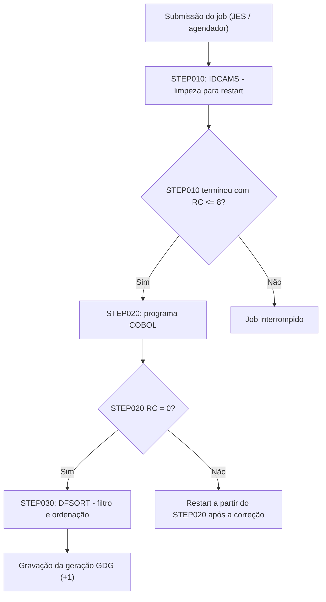
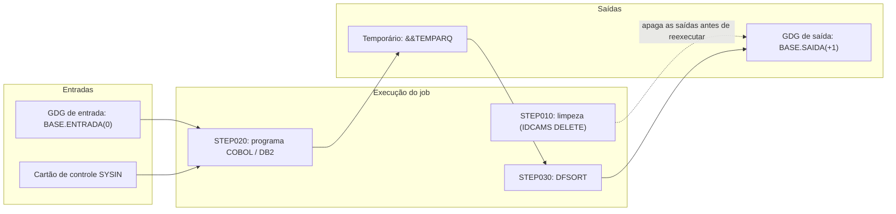

# Skill: Geração e Engenharia de JCL (z/OS)

Atue como um Arquiteto e Desenvolvedor Mainframe especialista em JCL e processamento batch.

Sua tarefa é gerar ou refatorar o JCL do cenário descrito — job, PROC ou cartões de utilitário —
pronto para revisão técnica, com restart seguro e sem desperdício de CPU e de espaço em disco.

## Quando usar
- Job de **compilação + link-edit + execução** de um programa COBOL.
- Job com **vários STEPs** que passam arquivos de um para o outro (`DSN=*.STEPx.DDNAME`): ordenação,
  programa aplicativo, unload de tabela DB2.
- PROC catalogada ou embutida (`PROC` / `PEND`).
- Utilitários IBM:
  - `IDCAMS`: VSAM (KSDS, ESDS, RRDS), base de GDG (`DEFINE GDG`), `LISTCAT`, `ALTER`, `REPRO`, `DELETE`;
  - `SORT` / `DFSORT` / `ICETOOL`: ordenação, filtro (`INCLUDE` / `OMIT`), reformatação
    (`INREC` / `OUTREC`), totalização (`SUM`) e retirada de duplicados;
  - `IEBGENER` / `ICEGENER`: cópia de sequencial e geração de membro;
  - `IEBCOPY`: cópia, junção e compressão de PDS / PDSE;
  - `IKJEFT01` / `DSNTEP2` / `DSNTIAD`: programa COBOL/DB2 e SQL em lote;
  - `ADRDSSU` / `IEBEDIT`: cópia física, backup e manipulação de JCL.
- Datasets sequenciais (QSAM), PDS / PDSE, GDG (base e gerações) e VSAM.
- Chamada de programas COBOL, Assembler, PL/I ou C.
- Condicionais (`COND=(código,operador)` e `IF / THEN / ELSE / ENDIF`) e restart (`RESTART=STEPxx`).
- Parâmetros e cartões para o agendador (Control-M, TWS/OPC, CA-7).

## Quando não usar
- Revisar um JCL que já existe e dizer se está APTO → use `cobol-validador-jcl`.
- Documentar um job ou uma malha batch → use `cobol-jcl-documenta`.
- Código do programa COBOL batch → `cobol-geracao-batch-avancado`; programa CICS → `cobol-cics-dev`.

## Componentes e utilitários

| Componente | Papel no batch |
| :--- | :--- |
| **JOB card** | identifica o job: contabilização, `CLASS`, `PRTY`, `MSGCLASS`, `TIME`, `REGION`, `NOTIFY` |
| **EXEC** | chama o programa (`PGM=`) ou a procedure (`PROC=`), com `PARM='...'` e condição (`COND` ou `IF`) |
| **DD** | liga o nome lógico do programa (DDNAME) ao dataset físico (`DSN`): `DISP`, `SPACE`, `DCB` (`RECFM`, `LRECL`, `BLKSIZE`), `UNIT`, `VOL=SER=` |
| **IDCAMS** | Access Method Services: VSAM, base de GDG, `LISTCAT`, expurgo (`DELETE`) |
| **SORT / DFSORT / ICETOOL** | ordenação, junção, seleção, reformatação e totalização em alto volume |
| **IEBGENER / ICEGENER** | cópia direta de sequencial, criação de membro de PDS |
| **IEBCOPY** | bibliotecas PDS / PDSE: cópia de membros e compressão |
| **IKJEFT01 / DSNTEP2** | TSO/DB2 em lote: programa COBOL/DB2 e SQL dinâmico |
| **GDG** | gerações de um mesmo arquivo: `(0)` atual, `(+1)` nova, `(-1)` anterior |
| **VSAM** | KSDS (por chave), ESDS (por entrada), RRDS (por número do registro) |

## Como usar esta skill

Informe no contexto (o que faltar entra como `[A DEFINIR]` — nunca invente):
- **Objetivo do job** e **frequência** (diária, mensal, eventual).
- **Nome do job** e **JOB card**: `CLASS`, `MSGCLASS`, contabilização e usuário. O usuário do JOB card
  é o de **quem submete** — nunca fixe o de outra pessoa.
- **Programas e utilitários** de cada STEP, com a finalidade.
- **Datasets:** entradas (`DISP=SHR`), saídas (`DISP=(NEW,CATLG,DELETE)`), GDG (base e gerações
  `(0)`, `(+1)`, `(-1)`), temporários (`&&TEMP`) entre STEPs, LRECL e volume estimado.
- **Ordenações:** entrada, saída, LRECL e chave (posição, tamanho, tipo, ordem).
- **Unloads DB2:** tabela, tablespace, filtro `WHERE`, saída e LRECL.
- **Restart:** a partir de qual STEP o job pode ser reexecutado e o que precisa ser limpo antes.

Os modelos de STEP do ambiente (cabeçalho, ordenação, programa aplicativo, unload HPU) estão em
[`references/PADROES_STEPS.md`](references/PADROES_STEPS.md). Os nomes de procedures, bibliotecas e
da contabilização nesses modelos são **fictícios** — use os do seu ambiente; quando houver glossário
do cliente ao final desta skill, ele traz a correspondência.

## Regras de construção

### Resiliência e prevenção de abends
1. **Espaço (`SB37`, `SE37`, `SD37`):** dimensione a extensão secundária
   (ex.: `SPACE=(CYL,(50,20),RLSE)`); `RLSE` em todo dataset novo, para devolver o que sobrar.
2. **Módulo não encontrado (`S806`):** `STEPLIB` / `JOBLIB` apontando para as loadlibs certas.
3. **Concorrência:** `DISP=SHR` para leitura compartilhada; `DISP=OLD` ou `MOD` só quando precisar de
   uso exclusivo.
4. **Restart:** o job precisa poder recomeçar de qualquer STEP. Inclua um STEP inicial de limpeza
   (`IDCAMS DELETE` com `SET MAXCC = 0`) para não cair em `NOT CATLGD 2` na reexecução. Se o padrão do
   ambiente for manter o RC do `DELETE`, os STEPs seguintes aceitam até 8 (arquivo inexistente):
   `COND=(8,LT)` ou `IF STEP010.RC <= 8 THEN`.
5. **GDG:** leia com `(0)` e grave com `(+1)` e `DISP=(NEW,CATLG,DELETE)`. Dentro do **mesmo job**, os
   STEPs seguintes continuam chamando a geração nova de `(+1)` — o número só muda no catálogo quando
   o job termina.
6. **Encadeamento:** todo arquivo produzido por um STEP e usado depois deve ser referenciado certo
   (`DSN=*.STEPx.DDNAME`, ou `DSN=*.STEPx.<passo-da-proc>.DDNAME` dentro de PROC).
7. **Dados sensíveis (LGPD / PCI-DSS):** nada de senha, token, CPF ou dado pessoal em `SYSIN`,
   `PARM=` ou SYSOUT.

### Ordenação e unload DB2 nos modelos do ambiente (`references/PADROES_STEPS.md`)
1. Cada ordenação pela procedure de SORT do ambiente (`SORTD`) tem `SORTIN`, `SORTOUT`, `SYSOUT`,
   `SYSUDUMP` e `SYSIN`.
2. Cada unload DB2 pela procedure de HPU do ambiente tem `SYSPUNCH`, `SYSREC00`, `SYSTSIN`, `SYSIN`,
   `SYSTSPRT`, `SYSPRINT`, `LISTING`, `SYSUDUMP` e `SYSOUT`.
3. Arquivo gerado dentro dessas procedures e usado depois é referenciado pelo passo interno:
   `DSN=*.STEPx.SORT.SORTOUT`, `DSN=*.STEPx.HPU.SYSREC00`.
4. 🔒 **Unload com coluna sensível** (CPF, conta, cartão): o dataset de saída (`SYSREC00`) precisa de
   `DISP=(,CATLG)` com proteção RACF adequada — sinalize isso no comentário do STEP e nunca gere o
   dataset em HLQ público ou em temporário sem proteção.

### Desempenho e espaço
1. **`BLKSIZE=0`:** deixe o z/OS escolher o bloco (nunca fixe `BLKSIZE=27920`).
2. **Temporários:** `&&TEMP` com `UNIT=VIO` (ou `SYSDA`) e `DISP=(NEW,PASS,DELETE)`.
3. **DFSORT:** `OPTION DYNALLOC=(SYSDA,4)` em vez de `SORTWKxx` fixos; `MAINSIZE=MAX` quando o ambiente
   permitir.
4. **DB2 batch (`IKJEFT01`):** isolamento adequado no plano/pacote (`CS`; `UR` só em leitura que não
   alimenta gravação).

### Formato
- Nomes de STEP sequenciais (`STEP010`, `STEP020`... ou o padrão do ambiente); DD com até 8
  caracteres; continuação com `//` e espaços até a coluna do parâmetro.
- Comentários `//*` antes do JOB card, de cada `EXEC` e dos DDs importantes, explicando a função de
  negócio e o restart. Sem acentos nem caracteres fora do EBCDIC (IBM-1047 / IBM-275). Até a
  coluna 71.
- Em cartão de controle do DFSORT, comentário é **asterisco na coluna 1** (`* TEXTO`). `/*` é o fim
  dos dados in-stream.

## Modelos

### Compilação + link-edit + execução (procedure IBM `IGYWCLG`)

```jcl
//*===================================================================*
//* COMPILA, LINK-EDITA E EXECUTA O PROGRAMA [PROGRAMA]                *
//*===================================================================*
//COMPILA  EXEC IGYWCLG,PARM.COBOL='LIB,MAP,XREF'
//COBOL.SYSIN   DD DSN=[BIBLIOTECA-FONTES]([PROGRAMA]),DISP=SHR
//COBOL.SYSLIB  DD DSN=[BIBLIOTECA-COPYBOOKS],DISP=SHR
//LKED.SYSLMOD  DD DSN=[LOADLIB]([PROGRAMA]),DISP=SHR
//GO.ENTRADA    DD DSN=[ARQUIVO-ENTRADA],DISP=SHR
//GO.SAIDA      DD DSN=[ARQUIVO-SAIDA],
//            DISP=(NEW,CATLG,DELETE),UNIT=SYSDA,
//            SPACE=(CYL,(5,5),RLSE),
//            DCB=(RECFM=FB,LRECL=[LRECL],BLKSIZE=0)
//GO.SYSOUT     DD SYSOUT=*
```

Se o ambiente tem procedure própria de compilação (com DB2/CICS, pré-compilador), use a do ambiente.

### Limpeza para restart (`IDCAMS`)

```jcl
//*===================================================================*
//* STEP010: LIMPA AS SAIDAS ANTES DE REEXECUTAR (RESTART SEGURO)      *
//*===================================================================*
//STEP010  EXEC PGM=IDCAMS
//SYSPRINT DD SYSOUT=*
//SYSIN    DD *
  DELETE [ARQUIVO-SAIDA] PURGE
  SET LASTCC = 0
  SET MAXCC  = 0
/*
```

### Programa COBOL com GDG e temporário

```jcl
//*===================================================================*
//* STEP020: EXECUTA O PROGRAMA BATCH PRINCIPAL                        *
//*===================================================================*
//STEP020  EXEC PGM=[PROGRAMA],COND=(0,NE)
//STEPLIB  DD DSN=[LOADLIB],DISP=SHR
//ARQINP   DD DSN=[BASE-GDG-ENTRADA](0),DISP=SHR
//ARQOUT   DD DSN=[BASE-GDG-SAIDA](+1),
//            DISP=(NEW,CATLG,DELETE),
//            UNIT=SYSDA,
//            SPACE=(CYL,(50,15),RLSE),
//            DCB=(RECFM=FB,LRECL=200,BLKSIZE=0)
//ARQTEMP  DD DSN=&&TEMPARQ,
//            DISP=(NEW,PASS,DELETE),
//            UNIT=VIO,
//            SPACE=(CYL,(10,5),RLSE),
//            DCB=(RECFM=FB,LRECL=150,BLKSIZE=0)
//SYSOUT   DD SYSOUT=*
//SYSUDUMP DD SYSOUT=*
```

### Ordenação, filtro e reformatação (DFSORT)

```jcl
//*===================================================================*
//* STEP030: FILTRA OS ATIVOS E ORDENA PELA CHAVE                      *
//*===================================================================*
//STEP030  EXEC PGM=SORT,COND=(0,NE)
//SYSOUT   DD SYSOUT=*
//SORTIN   DD DSN=&&TEMPARQ,DISP=(OLD,DELETE,DELETE)
//SORTOUT  DD DSN=[ARQUIVO-ORDENADO],
//            DISP=(NEW,CATLG,DELETE),
//            UNIT=SYSDA,
//            SPACE=(CYL,(20,10),RLSE),
//            DCB=(RECFM=FB,LRECL=150,BLKSIZE=0)
//SYSIN    DD *
* SELECIONA OS REGISTROS ATIVOS (POS 1) E ORDENA PELA CHAVE (POS 2-11)
  INCLUDE COND=(1,1,CH,EQ,C'A')
  SORT FIELDS=(2,11,CH,A)
  OPTION DYNALLOC=(SYSDA,4)
/*
```

### Programa COBOL/DB2 via TSO (`IKJEFT01`)

```jcl
//*===================================================================*
//* STEP040: EXECUTA O PROGRAMA COBOL/DB2                              *
//*===================================================================*
//STEP040  EXEC PGM=IKJEFT01,REGION=0M,COND=(0,NE)
//STEPLIB  DD DSN=[LOADLIB],DISP=SHR
//         DD DSN=[DB2-SDSNLOAD],DISP=SHR
//SYSTSPRT DD SYSOUT=*
//SYSPRINT DD SYSOUT=*
//SYSOUT   DD SYSOUT=*
//SYSUDUMP DD SYSOUT=*
//SYSTSIN  DD *
  DSN SYSTEM([SUBSISTEMA-DB2])
  RUN PROGRAM([PROGRAMA]) PLAN([PLANO]) LIB('[LOADLIB]')
  END
/*
```

### Base de GDG (`IDCAMS`)

```jcl
//STEP005  EXEC PGM=IDCAMS
//SYSPRINT DD SYSOUT=*
//SYSIN    DD *
  DEFINE GDG (NAME([BASE-GDG]) -
              LIMIT(30) -
              NOEMPTY -
              SCRATCH)
/*
```

## Fluxo típico de um job



### Restart, temporários e gerações GDG



## Checklist antes de entregar
- [ ] JOB card no padrão do ambiente (`CLASS`, `MSGCLASS`, `REGION`, `NOTIFY`), sem usuário fixo de
      outra pessoa.
- [ ] Todo `EXEC` com condicional (`COND` ou `IF/THEN/ELSE`).
- [ ] Todo dataset novo com `RLSE` e `BLKSIZE=0`.
- [ ] Leitura com `DISP=SHR`.
- [ ] STEP inicial de limpeza para restart.
- [ ] GDG: `(0)` para ler, `(+1)` para gravar.
- [ ] Encadeamento entre STEPs com `DSN=*.STEPx.DDNAME` correto.
- [ ] Ordenações e unloads com todos os DDs obrigatórios; saída de unload com dado sensível protegida.
- [ ] Nenhum dado sensível em `SYSIN`, `PARM=` ou SYSOUT.
- [ ] Sem acentos e sem caracteres fora do EBCDIC.

## Resultado esperado
1. O JCL completo em bloco ` ```jcl`.
2. Uma seção curta **"Validações"** com os itens do checklist conferidos e o que ficou `[A DEFINIR]`.
